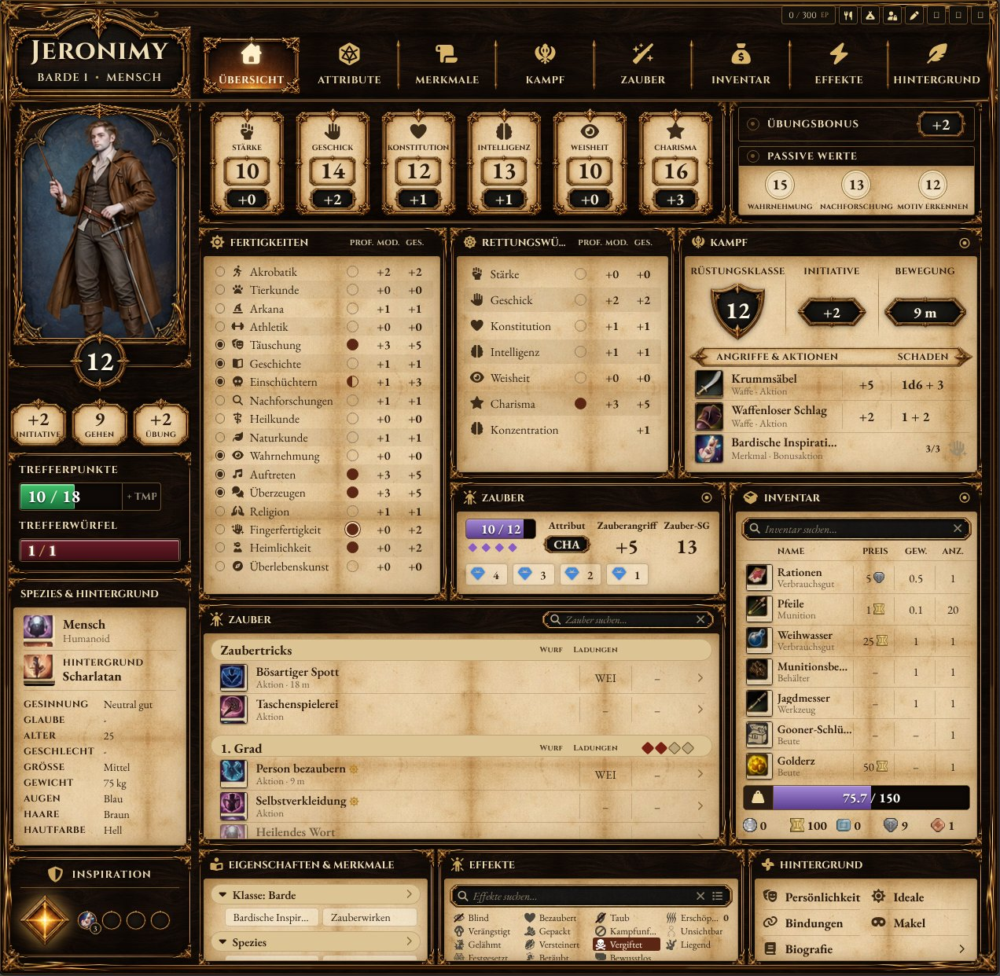

# Ascandir – DnD5e Character Sheet

Alternativer Charakterbogen für **Foundry VTT v14** und das System **dnd5e 6.x**.



## Installation

In Foundry unter *Add-on Modules → Install Module* diese Manifest-URL eintragen:

```
https://github.com/Ascandir/Ascandir---DnD5e-Character-Sheet/releases/latest/download/module.json
```

Modul in der Welt aktivieren, dann am Charakter über **⋮ → Configure Sheet / Bogen konfigurieren**
bei „This Sheet" **Ascandir Sheet** wählen (oder als „Default Sheet" für alle Charaktere).
Im selben Fenster lässt sich unter **Theme** das Aussehen wählen.

## Funktionen

- **Passt sich dem Fenster an**: Der Bogen ist für ca. 1270 × 1240 Pixel gestaltet. Wird das Fenster kleiner
  oder größer, wachsen bzw. schrumpfen die Panels mit, bei schmalen Fenstern ordnen sie sich in zwei bzw.
  eine Spalte um – Schrift und Symbole bleiben gleich groß. Die zuletzt gewählte Fenstergröße wird gemerkt.
- **Übersicht** auf einer Seite, aufgebaut wie der Design-Entwurf: Attribute, Übungsbonus, passive Werte, Fertigkeiten, Rettungswürfe,
  Kampfwerte mit Angriffen, Zauberwerte und Zauberplätze, Zauberbuch, Inventar mit Traglast und Geld,
  Merkmale, Zustände, Hintergrund. Alles ist anklickbar (würfeln, benutzen, wirken). Suchfelder für
  Zauber, Inventar und Effekte filtern sofort. Kreise links bei den Fertigkeiten markieren Favoriten,
  Favoriten erscheinen als runde Schnellzugriffe neben der Inspiration (Ablegen per Drag & Drop).
  Zauberplatz-Kacheln: Klick verbraucht einen Platz, Umschalt+Klick gibt einen zurück.
- **Fensterleiste**: EP, kurze/lange Rast, Bearbeiten und die SL-Freigabe sitzen als kleine Knöpfe oben rechts.
- **Attribute-Tab**: Attributskarten mit Attributs- und Rettungswurf, Fertigkeiten mit Attribut und Passivwert,
  Rettungswürfe, Werkzeuge, Herkunft sowie Sinne, Resistenzen, Übungen und Sprachen.
- **Alle anderen Tabs** (Merkmale, Zauber, Inventar, Effekte, Hintergrund, Spezial) nutzen weiter die Original-Listen
  des Systems, aber im Look des Bogens.
- **Kampf-Tab**: alle Aktionen nach Aktion/Bonusaktion/Reaktion, Todesrettungswürfe, Zustände.
- **Charakter einrichten**: Bei leeren Bögen Buttons für Klasse, Spezies und Hintergrund
  (Kompendium-Browser + Stufenaufstieg des Systems).
- **Bearbeiten nur mit Freigabe**: Der SL hat im Kopf des Bogens einen Schloss-Button, mit dem er den
  Bearbeitungsmodus für die Spieler dieses Charakters freigibt oder sperrt. Würfeln, TP, Gegenstände
  benutzen, Geld usw. funktionieren immer.
- **Themes/Skins**: „Pergament & Holz“, „Nachtwache“ (Silber/Schiefer), „Blutmond“ (Gotisch, Rot/Gold)
  und „Arkanum“ (Nachtblau, farbige Attributskarten). Weitere lassen sich einfach ergänzen –
  siehe [THEMES.md](THEMES.md).
- **Kompatibel zum Standardbogen**: Der Bogen erweitert den originalen dnd5e-Bogen. Inventar, Zauber,
  Merkmale, Effekte, Biografie, Bastion und Spezial nutzen die Original-Bausteine, Hooks wie
  `renderCharacterActorSheet` feuern weiter, Header-Buttons anderer Module (z. B. Plutonium,
  Equipment Shop) bleiben erhalten, und Tabs, die andere Module dem Standardbogen hinzufügen,
  werden automatisch übernommen.

Weitere Ansichten: [Nachtwache-Theme](docs/nightwatch.jpg) · [Leerer Bogen mit Einrichtung](docs/setup.jpg)

## Einstellungen

| Einstellung | Bereich | Bedeutung |
|---|---|---|
| Standard-Theme (Welt) | Welt | Theme für alle ohne eigene Wahl |
| Mein Theme | Spieler | persönliches Theme |
| Bearbeitungsmodus für Spieler | Welt | nur mit SL-Freigabe pro Charakter, oder immer |
| Spieler dürfen leere Charaktere einrichten | Welt | erste Klasse/Spezies/Hintergrund ohne Freigabe |

Hinweis: Die Sperre wirkt auf dem Bogen. Besitzer eines Charakters können ihn technisch weiterhin
über andere Wege (z. B. Makros oder Importer) ändern.

## Schnittstelle für andere Module

```js
const api = game.modules.get("ascandir-dnd5e-character-sheet").api;
api.registerTheme({ id, label, base, stylesheet });
api.sheetClass; // die Bogen-Klasse
```

## Lizenzen

Grafiken des Themes „Pergament & Holz“ (`assets/parchment/`): erstellt von Ascandir mit ChatGPT.

Schriften Cinzel und EB Garamond: SIL Open Font License (siehe `fonts/`).
